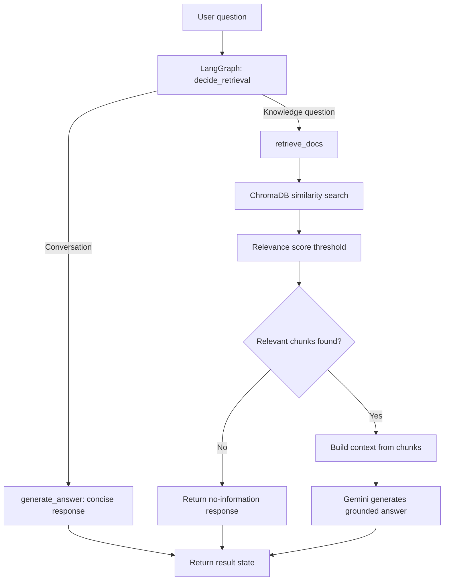

# RAG System — Programming Document Question Answering

A Python-based Retrieval-Augmented Generation (RAG) learning project that answers questions using programming-course documents. The current implementation uses **LangGraph** to orchestrate a conditional RAG workflow, **ChromaDB** for persistent vector storage, **Hugging Face sentence-transformer embeddings** for semantic retrieval, and **Google Gemini** for answer generation.

> **Project status:** This repository currently implements a basic **conditional RAG pipeline**. It has a LangGraph state graph and a retrieval decision, but it does not yet implement the full agentic-RAG features such as LLM-based relevance grading, query rewriting, retrieval retries, web-search fallback, or answer verification.

## Table of Contents

- [Features](#features)
- [Architecture](#architecture)
- [Technology Stack](#technology-stack)
- [Project Structure](#project-structure)
- [Prerequisites](#prerequisites)
- [Installation](#installation)
- [Environment Configuration](#environment-configuration)
- [Adding Source Documents](#adding-source-documents)
- [Running the Notebook](#running-the-notebook)
- [How the Pipeline Works](#how-the-pipeline-works)
- [Retrieval and Chunking Configuration](#retrieval-and-chunking-configuration)
- [Error Handling and API Quotas](#error-handling-and-api-quotas)
- [Troubleshooting](#troubleshooting)
- [Current Limitations and Future Improvements](#current-limitations-and-future-improvements)
- [Security Notes](#security-notes)

## Features

- Loads PDF documents from a local directory.
- Splits loaded documents into overlapping text chunks.
- Generates embeddings using `sentence-transformers/all-MiniLM-L6-v2` through `HuggingFaceEmbeddings`.
- Stores vectors and document metadata persistently in ChromaDB.
- Creates deterministic document IDs from chunk text and metadata to avoid inserting duplicate IDs on repeated runs.
- Retrieves the top candidate chunks using semantic similarity and filters them by a relevance-score threshold.
- Uses LangGraph to route conversational messages separately from questions that require document retrieval.
- Instructs Gemini to answer from retrieved context only and to acknowledge missing information.
- Handles common Gemini errors, including rate limits, authentication failures, invalid requests, and unavailable model names.

## Architecture



### Main components

1. **Document loading** — `DirectoryLoader` and `PyMuPDFLoader` read PDF files from `Data/Pdf_files/`.
2. **Chunking** — `RecursiveCharacterTextSplitter` divides documents into chunks of 1,000 characters with 200 characters of overlap.
3. **Embeddings** — `HuggingFaceEmbeddings` loads `sentence-transformers/all-MiniLM-L6-v2` and normalizes embeddings. The model is initialized once per notebook kernel session.
4. **Vector storage** — `Chroma` persists the collection in `Data/vector_store/` using the collection name `Programming_Courses` and cosine distance configuration.
5. **Retrieval** — `retrieve_relevant_docs()` fetches up to four candidates and retains documents whose relevance score is at least `0.45`.
6. **Workflow orchestration** — LangGraph routes the question to retrieval or directly to answer generation.
7. **Answer generation** — `ChatGoogleGenerativeAI` uses a prompt that requires evidence from retrieved context and asks the model to state when the context is insufficient.

## Technology Stack

| Component | Library / Service | Purpose |
|---|---|---|
| Language | Python | Application and notebook code |
| Notebook environment | Jupyter Notebook / VS Code | Interactive development and testing |
| Workflow orchestration | LangGraph | State graph and conditional routing |
| LLM integration | `langchain-google-genai` | Calls the Gemini API |
| Prompt and document abstractions | `langchain-core` | Prompts, documents, and core interfaces |
| PDF ingestion | `langchain-community`, PyMuPDF | Loads PDF content |
| Text splitting | `langchain-text-splitters` | Creates overlapping chunks |
| Embeddings | `langchain-huggingface`, Sentence Transformers | Converts text into vectors |
| Vector database | `langchain-chroma`, ChromaDB | Persists vectors and performs similarity search |
| Environment variables | `python-dotenv` | Loads local API credentials and model configuration |

## Project Structure

The following is the intended structure for the components used by the notebook. Names may differ slightly in the local repository; keep the notebook paths consistent with the actual folders.

```text
RAG_System/
├── Data/
│   ├── Pdf_files/              # PDF documents used as the knowledge base
│   └── vector_store/           # Persistent ChromaDB data (generated locally)
├── AgenticRAG/
│   └── agentic_Rag.ipynb       # Main RAG workflow notebook (if stored here)
├── .env                       # Local API key and model configuration; do not commit
├── .gitignore
├── pyproject.toml              # Project dependencies, if managed with uv
├── requirements.txt            # Alternative pip dependency list, if maintained
└── README.md
```

The notebook currently loads PDFs using the relative path `../Data/Pdf_files/`. If the notebook is not located one directory below the project root, update that path accordingly. The vector-store code searches the current directory and its parents for a directory named `Data` before choosing `Data/vector_store/`.

## Prerequisites

- Python installed in a virtual environment. The project has been developed in a Python 3.13 environment; compatible package versions may depend on your operating system and installed dependencies.
- Git, if you intend to clone or contribute to the repository.
- A Google Gemini API key with access to a supported model and available quota.
- The source PDF files you want the system to search.
- Internet access for installing packages and downloading the embedding model on first use. Once downloaded, the embedding model may be cached locally.

## Installation

### Option A — Clone the repository

```bash
git clone https://github.com/mrsharadshinde/RAG_System.git
cd RAG_System
```

### Option B — Use the existing local project

Open the existing `RAG_System` folder in VS Code. Activate the project's virtual environment before installing or running dependencies.

### Install dependencies

If the repository's `pyproject.toml` is managed with `uv`, use the dependency workflow already configured in that file, for example:

```bash
uv sync
```

If you maintain a `requirements.txt` instead, install from it:

```bash
python -m pip install -r requirements.txt
```

The active notebook imports packages from these distributions:

```bash
python -m pip install \
  langgraph \
  langchain-core \
  langchain-community \
  langchain-text-splitters \
  langchain-google-genai \
  langchain-chroma \
  langchain-huggingface \
  sentence-transformers \
  pymupdf \
  python-dotenv
```

Prefer the project's pinned dependency file over installing unpinned packages when one is available. Select the virtual environment as the Jupyter kernel in VS Code.

## Environment Configuration

Create a `.env` file in the project root. Do not commit this file.

```dotenv
GEMINI_KEY=your_gemini_api_key
MODELNM=gemini-2.5-flash
```

`MODELNM` must contain an API model ID supported by your Google AI Studio project, not a display label such as `Gemini 2.5 Flash`. The example above is an example configuration; model availability, quota, and access can vary by project and may change over time.

The notebook loads the variables with `load_dotenv()` and reads them using `os.getenv()`:

- `GEMINI_KEY` — API key passed to `ChatGoogleGenerativeAI`.
- `MODELNM` — model ID passed to the Gemini chat model wrapper.

If you change `.env` while a notebook kernel is running, reload the environment with `load_dotenv(override=True)` and rerun the cell that initializes `llm`. Alternatively, restart the kernel and run the notebook from the beginning.

## Adding Source Documents

1. Put the PDFs you want to query in `Data/Pdf_files/`.
2. Confirm the notebook's PDF loader path points to that directory.
3. Run the document-loading and chunking cells.
4. Run the vector-store cell to add or update the chunks in ChromaDB.

The notebook currently uses a programming-language PDF as its demonstration source. Answers are limited to the content actually loaded into the vector store; the model should not be treated as having access to files that were not ingested.

### Persistent storage and deterministic IDs

The notebook generates a SHA-256 ID from each chunk's text and metadata. When a matching ID exists, the code updates that record; otherwise, it inserts a new record. This prevents repeated ingestion from adding another record with the same deterministic ID. It does **not** automatically remove legacy duplicate records previously inserted with different IDs. Back up `Data/vector_store/` before manually deleting or rebuilding a collection.

## Running the Notebook

1. Open the main RAG notebook in VS Code or Jupyter.
2. Select the project's Python virtual environment as the kernel.
3. Ensure `Data/Pdf_files/` contains at least one readable PDF.
4. Ensure `.env` contains a valid `GEMINI_KEY` and a supported `MODELNM` value.
5. Run the notebook cells in order, from imports and environment setup through vector-store initialization and graph compilation.
6. Use the `ask_question()` helper to submit a question:

```python
result = ask_question(
    "How does the C programming language implement a stack?"
)

print(result["answer"])
```

### Suggested smoke tests

```python
questions = [
    "Hi",
    "What is quantum computing?",
    "How does the C programming language implement a stack?",
]

for question in questions:
    result = ask_question(question)
    print(f"\nQuestion: {question}")
    print(f"Needs retrieval: {result['needs_retrieval']}")
    print(f"Answer: {result['answer']}")
```

Expected behavior:

- `Hi` should take the conversational path and not require document retrieval.
- A question unrelated to the ingested PDFs should return a no-relevant-information response if all retrieved candidates fall below the threshold.
- A question covered by the PDFs should retrieve relevant chunks and generate an answer based on their content, subject to LLM availability and quota.

These are behavioral checks, not a guarantee that every response is factually correct. Review the retrieved context and generated answers for important use cases.

## How the Pipeline Works

### 1. Retrieval decision

`decide_retrieval()` currently uses a small list of exact conversational phrases, such as `hi`, `hello`, `thanks`, and `goodbye`. Messages matching that list bypass retrieval. Other non-empty questions are routed to retrieval by default. This is a lightweight heuristic, not an LLM-based intent classifier; other conversational phrases may be routed to retrieval unnecessarily.

### 2. Retrieval and relevance filtering

`retrieve_relevant_docs(question, k=4, threshold=0.45)` calls ChromaDB's relevance-score search and keeps only candidates with scores greater than or equal to `0.45`. The current threshold was checked against a small set of examples and is provisional. Relevance scores can vary with the embedding model, vector-store configuration, and dataset. Evaluate it against representative relevant and irrelevant questions before relying on it for a larger corpus.

The retrieval helper prints candidate counts, scores, and short text previews for debugging. These diagnostics are useful while developing, but should be reduced or replaced with structured logging in a production application.

### 3. Answer generation

When retrieval was required but no chunks passed the threshold, the graph returns a fixed message indicating that the available PDFs did not contain relevant information. Otherwise, the retrieved text is joined into a context and sent to Gemini with instructions to:

- use only facts supported by the context;
- avoid unsupported inferences or outside knowledge;
- preserve distinctions between different examples and concepts; and
- acknowledge when the context only partially answers the question.

Conversational messages bypass document retrieval and are sent directly to the model for a concise response.

### 4. LangGraph workflow

The graph uses an `AgentState` containing the question, retrieved documents, answer, and retrieval-decision flag. Its nodes are `decide`, `retrieve`, and `generate`. Conditional edges select whether the question goes through retrieval before generation.

Although the notebook is named `agentic_Rag.ipynb`, this is currently a **conditional RAG workflow**, not a complete agentic retrieval system. The graph does not yet grade document relevance with an LLM, rewrite questions, loop through retries, or verify generated answers.

## Retrieval and Chunking Configuration

| Setting | Current value | Notes |
|---|---|---|
| Chunk size | `1000` characters | Configured in `RecursiveCharacterTextSplitter` |
| Chunk overlap | `200` characters | Preserves some context between neighboring chunks |
| Retrieval candidates (`k`) | `4` | Number of nearest chunks requested |
| Relevance threshold | `0.45` | Provisional minimum relevance score |
| Embedding model | `sentence-transformers/all-MiniLM-L6-v2` | Runs on CPU and normalizes embeddings |
| Chroma collection | `Programming_Courses` | Persistent collection name |
| Chroma distance space | `cosine` | Configured when creating the collection |

Change these settings only after testing retrieval quality on your own document set. Changing the embedding model may require rebuilding or migrating the vector store because stored vectors must be compatible with the embedding function used at query time.

## Error Handling and API Quotas

The notebook catches several Gemini errors and returns a user-facing message for rate limits, authentication errors, invalid requests, missing models, and other failures. The model client is configured with `max_retries=2`.

A controlled error message does not mean the request succeeded. Check the notebook output for the diagnostic exception when a request fails.

Common cases:

- **HTTP 429 / `RESOURCE_EXHAUSTED`:** The project may have reached a request or token quota. Check the quota dashboard and model-specific limits. Waiting helps only if the quota resets; it does not fix exhausted billing credits or a project-level restriction.
- **Authentication failure:** Verify `GEMINI_KEY`, ensure it is valid, and check that the key belongs to the intended Google project.
- **Model not found / unavailable:** Verify `MODELNM` against the model IDs available to your project. Do not use the human-readable display name as the API ID.
- **Invalid request:** Inspect the complete diagnostic exception and verify the model's supported request parameters.
- **PDFs not found:** Confirm the relative path used by `DirectoryLoader` and ensure the PDFs are readable.
- **Unexpectedly low retrieval scores:** Inspect retrieved text and scores, verify the correct documents were ingested, and evaluate the threshold rather than assuming a single threshold fits every dataset.

Google AI Studio: <https://aistudio.google.com/>  
Gemini API documentation: <https://ai.google.dev/gemini-api/docs>

## Troubleshooting

### `Failed to load Gemini key`

Confirm `.env` is in the working directory from which `load_dotenv()` can discover it. Check the spelling of `GEMINI_KEY`. Do not print or commit the key itself.

### The configured model cannot be found

Check the exact value printed by `MODEL_NAME`. Set `MODELNM` to an API model ID available to your project, reload the environment, and recreate `llm`.

### No PDF documents loaded

Check the `DirectoryLoader` path. The notebook currently uses `../Data/Pdf_files/`, which assumes the notebook runs from a directory one level below the project root. Adjust the path if your structure differs.

### ChromaDB reports existing records updated

That is expected when deterministic IDs for the ingested chunks already exist. The function updates matching records and inserts only records whose IDs are new. The total count may remain unchanged on repeated ingestion.

### A greeting still prints retrieval logs

The normal graph should bypass `retrieve_docs()` for exact conversational phrases recognized by `decide_retrieval()`. If retrieval logs appear during a greeting test, check whether a separate diagnostic call to `retrieve_relevant_docs()` is being executed in another cell or test block.

## Current Limitations and Future Improvements

- The retrieval decision is based on exact phrase matching, not semantic intent classification.
- The similarity threshold is provisional and has only been checked with a small number of examples.
- A similarity score does not guarantee that a chunk contains sufficient evidence to answer the question.
- There is no LLM-based document relevance grader, query rewriting, iterative retrieval, or web-search fallback.
- There is no separate answer-verification or citation-generation stage.
- API errors are converted to readable messages, but quota exhaustion cannot be resolved by application-level exception handling alone.
- The notebook is a learning and experimentation artifact; it is not packaged as a production API or user interface.
- The vector store can retain older records created with different IDs; the current code does not automatically deduplicate those legacy entries.

Possible future improvements include:

1. Add a relevance-grading node that decides whether retrieved chunks answer the question.
2. Add query rewriting when retrieval quality is poor.
3. Add a bounded retrieval loop with explicit stopping conditions.
4. Add answer verification and source metadata in the response.
5. Create a repeatable evaluation set of supported and unsupported questions and measure retrieval quality.
6. Move reusable code from the notebook into a Python package with configuration and logging.
7. Add automated tests for routing, empty retrieval, score filtering, and error handling.

## Security Notes

- Never commit `.env`, API keys, credentials, or other secrets.
- Add `.env` and local generated data to `.gitignore` as appropriate. Decide deliberately whether source PDFs and the generated ChromaDB directory belong in version control; PDFs may have licensing restrictions and vector stores can be large and reproducible from source documents.
- Do not commit private or copyrighted documents unless you have permission to distribute them.
- Review and pin dependencies before using the project in a shared or production environment.

## License and Source Documents

Add a `LICENSE` file if you intend to distribute this project under an open-source license. Confirm the licensing and redistribution permissions of each source PDF before publishing it in the repository. This README does not assign a license to third-party documents.
